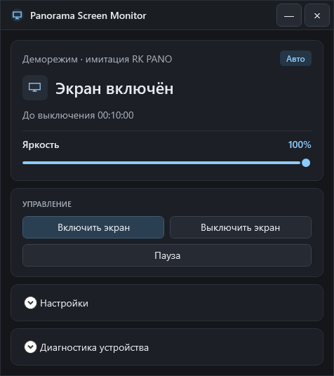

# Panorama Screen Monitor

[Русский](../../README.md) · **English** · [Deutsch](README.de.md) · [Français](README.fr.md) · [Español](README.es.md) · [Português (Brasil)](README.pt-BR.md) · [简体中文](README.zh-CN.md) · [日本語](README.ja.md)

**Automatic backlight control for the TRYX Panorama AIO display on Windows.**

The Panorama screen can stay lit after you step away and your main monitor has already gone dark. Panorama Screen Monitor runs in the system tray, turns off the AIO backlight after idle time, and wakes it when you return.

**Tested on TRYX Panorama `391A:1011` with KANALI 2.7.0.**

About six months ago, I asked the KANALI developers to add automatic backlight shutoff when the PC is idle. The feature was still missing when I prepared this release, so I wrote this utility.

[Download for Windows x64](https://github.com/Viper029GH/PanoramaScreenMonitor/releases/latest) · [Changelog](../../CHANGELOG.md) · [CC0 1.0](../../LICENSE)

<p align="center">
  
</p>

## Quick start

**Requirements:** Windows x64, a TRYX Panorama with the RK PANO USB device (`391A:1011`), and KANALI running normally.

1. Download the EXE or Windows x64 ZIP from the [latest release](https://github.com/Viper029GH/PanoramaScreenMonitor/releases/latest). Extract the ZIP if you chose it.
2. Launch the EXE. It is portable and includes .NET. If KANALI starts later, the utility will wait for it automatically.
3. The default timeout is **10 minutes**. To follow the main display timeout, expand **Settings**, select **Use Windows display timeout**, and click **Save**.

Closing the window sends the utility to the tray. To exit, choose **Exit** from the tray menu. Stop any existing Panorama backlight script before launching the utility.

The build is unsigned. Release file checksums are listed in `SHA256SUMS.txt`.

## Features

| Feature | How it works |
| --- | --- |
| Automatic control | Use a custom timeout from 1 to 1440 minutes or follow the Windows display timeout. The utility follows the current AC or battery setting. **Never** disables automatic shutoff. |
| Manual control and pause | Turn the backlight on or off from the window or tray. Pause holds the current state. Automatic control can be resumed at any time. |
| Brightness | The 0–100% slider is available while the screen is on. Changes are verified by reading the device. |
| Diagnostics | Model, firmware, screen software and OS, USB and UDB status, brightness, and the last successful read. |
| Windows settings | Start with Windows or in the tray. Choose a light or dark theme or follow the system setting. |
| Interface languages | Russian, English, German, French, Spanish, Brazilian Portuguese, Simplified Chinese, and Japanese. |

## How it works

The utility measures idle time using the last input in Windows. It sends backlight commands through the device's standard USB interface with shared access. KANALI keeps running while Panorama Screen Monitor finds the matching reply in the UDB log and checks the actual screen state. For power and brightness changes, the utility reads a fresh configuration and preserves the other fields. It skips the write if it cannot interpret the full configuration.

Sync uses the display timeout from the active Windows power plan. Video playback, manually switching off the monitor, and other events can affect the main display independently.

Settings and a small diagnostic log live in `%LOCALAPPDATA%\PanoramaScreenMonitor`. When reporting an issue, include the KANALI version, the firmware version shown in diagnostics, and the steps to reproduce it.

## Build from source

Building requires the **.NET 10 SDK**. The project uses C# and WPF.

```powershell
dotnet publish -c Release -r win-x64 --self-contained true -o artifacts/publish/win-x64
.\artifacts\publish\win-x64\PanoramaScreenMonitor.exe --demo
```

Demo mode lets you try the interface and simulate idle, input, errors, and timeouts without the cooler. Run `PanoramaScreenMonitor.exe --self-test "<report path>"` to test the protocol, UDB log parsing, and controller against simulations.

Run `./scripts/build-release.ps1` in PowerShell from the repository root. The [release script](../../scripts/build-release.ps1) verifies the build and puts the EXE, ZIP, .NET notices, and SHA-256 checksums in `artifacts/releases/`. The version is set in the [project file](../../PanoramaScreenMonitor.csproj).

The implementation uses the published documentation for device commands and fields. [TRYX transport schema](https://github.com/DXVSI/Tryx-Linux-GUI/blob/production/protocol/wire-v1/transport.proto) · [Configuration schema](https://github.com/DXVSI/Tryx-Linux-GUI/blob/production/protocol/wire-v1/configuration.proto)

## License

Project source and documentation are available under [CC0 1.0 Universal](../../LICENSE). The bundled .NET runtime has separate terms listed in `THIRD-PARTY-NOTICES.txt` in the release.
