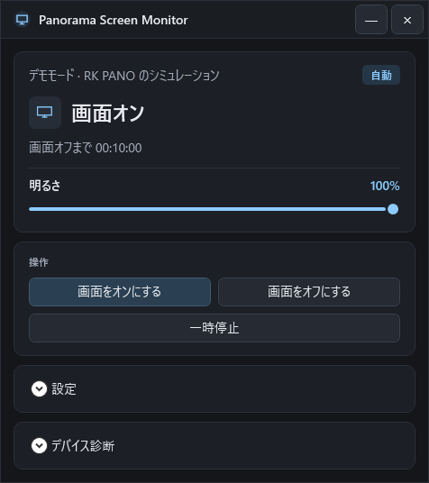

# Panorama Screen Monitor

[Русский](../../README.md) · [English](README.en.md) · [Deutsch](README.de.md) · [Français](README.fr.md) · [Español](README.es.md) · [Português (Brasil)](README.pt-BR.md) · [简体中文](README.zh-CN.md) · **日本語**

**Windows で TRYX Panorama 水冷クーラーの画面バックライトを自動制御するツールです。**

パソコンから離れてメインモニターが消灯しても、Panorama の画面は点灯したままになることがあります。Panorama Screen Monitor は通知領域で動作し、無操作が続くとバックライトを消灯し、操作を再開すると点灯します。

**TRYX Panorama `391A:1011` と KANALI 2.7.0 の組み合わせで動作確認済みです。** その他の USB モデルは実験的対応です。読み取り確認に成功した場合のみ画面を操作できます。[USB 互換性](README.en.md#usb-compatibility)

約半年前、KANALI の開発元に無操作時の自動消灯機能を要望しました。このリリースの準備時点でもその機能が追加されていなかったため、このツールを作りました。

[Windows x64 版をダウンロード](https://github.com/Viper029GH/PanoramaScreenMonitor/releases/latest) · [Changelog](../../CHANGELOG.md) · [CC0 1.0](../../LICENSE)

<p align="center">
  
</p>

## クイックスタート

**動作条件:** Windows x64、[USB 互換性表](README.en.md#usb-compatibility)に記載されている TRYX Panorama、および通常どおり起動した KANALI。

1. [最新リリース](https://github.com/Viper029GH/PanoramaScreenMonitor/releases/latest)から Windows x64 用の EXE または ZIP を取得します。ZIP を選んだ場合は展開してください。
2. EXE を実行します。インストール不要で .NET を同梱しています。後から KANALI が起動する場合は、ツールが自動的に待機します。
3. 既定の無操作時間は **10 分**です。メインモニターと同じ時間を使うには、**設定**を開き、**Windows の画面タイムアウトを使用**を選んで**保存**します。

ウィンドウを閉じても通知領域で動作します。完全に終了するには、通知領域アイコンのメニューから**終了**を選びます。Panorama のバックライトを操作する別のスクリプトが動いている場合は、先に停止してください。

EXE にはデジタル署名がありません。各ファイルのチェックサムは `SHA256SUMS.txt` に記載されています。

## 機能

| 機能 | 説明 |
| --- | --- |
| 自動制御 | 1〜1440 分の独自タイムアウト、または Windows の画面タイムアウトを使用します。AC 電源とバッテリーの設定を切り替えます。**オフにしない**設定では自動消灯しません。 |
| 手動制御と一時停止 | ウィンドウや通知領域から画面をオン・オフできます。一時停止では現在の状態を維持し、いつでも自動制御に戻せます。 |
| 明るさ | 画面が点灯しているときに 0〜100% の範囲で調整できます。変更はデバイスの読み取りで確認します。 |
| デバイス診断 | モデル、ファームウェア、画面ソフトウェアと OS、USB と UDB の状態、明るさ、最終読み取り日時を表示します。 |
| Windows 連携 | Windows と同時に起動するか、通知領域に格納して起動できます。テーマはライト、ダーク、システム設定から選べます。 |
| 表示言語 | ロシア語、英語、ドイツ語、フランス語、スペイン語、ブラジルポルトガル語、簡体字中国語、日本語。 |

## 仕組み

Windows への最終入力から無操作時間を計算し、共有アクセスでデバイスの標準 USB インターフェイスにコマンドを送ります。KANALI が動作を続ける間、Panorama Screen Monitor は UDB ログから対応する応答を探し、画面の実際の状態を確認します。設定変更の前に最新の構成を読み出し、ほかのフィールドは保持します。全体を解釈できない構成への書き込みは中止します。

同期機能はアクティブな Windows 電源プランの画面タイムアウトを使用します。動画再生や手動消灯などは、メインモニターに個別に影響することがあります。

設定と小さな診断ログは `%LOCALAPPDATA%\PanoramaScreenMonitor` に保存されます。不具合の報告には KANALI のバージョン、診断画面に表示されるファームウェアのバージョン、再現手順を添えてください。

## ソースからビルドする

ビルドには **.NET 10 SDK** が必要です。C# と WPF を使用しています。

```powershell
dotnet publish -c Release -r win-x64 --self-contained true -o artifacts/publish/win-x64
.\artifacts\publish\win-x64\PanoramaScreenMonitor.exe --demo
```

デモモードでは機器なしで画面を試し、無操作、入力、エラーやタイムアウトを再現できます。`PanoramaScreenMonitor.exe --self-test "<レポートのパス>"` でプロトコル、UDB ログ処理、制御ロジックのシミュレーションテストを実行できます。

リポジトリのルートで PowerShell から `./scripts/build-release.ps1` を実行します。[スクリプト](../../scripts/build-release.ps1)はビルドを検証し、EXE、ZIP、.NET のライセンス通知、SHA-256 チェックサムを `artifacts/releases/` に出力します。バージョン番号は[プロジェクトファイル](../../PanoramaScreenMonitor.csproj)にあります。

デバイスのコマンドやフィールドは公開仕様を参考にしています。[TRYX のトランスポート定義](https://github.com/DXVSI/Tryx-Linux-GUI/blob/production/protocol/wire-v1/transport.proto) · [構成の定義](https://github.com/DXVSI/Tryx-Linux-GUI/blob/production/protocol/wire-v1/configuration.proto)

## ライセンス

プロジェクトのソースコードと文書は [CC0 1.0 Universal](../../LICENSE) で公開しています。同梱の .NET ランタイムにはリリース内の `THIRD-PARTY-NOTICES.txt` に記載された別の条件が適用されます。
